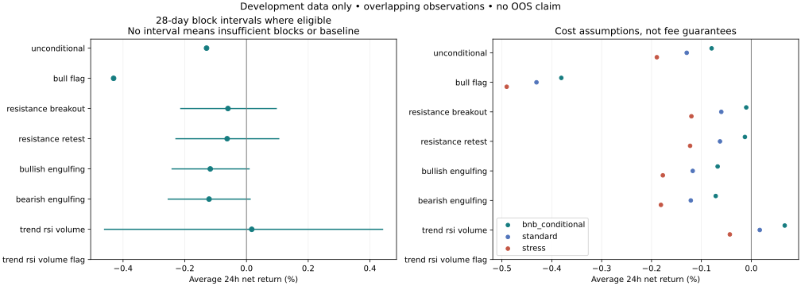
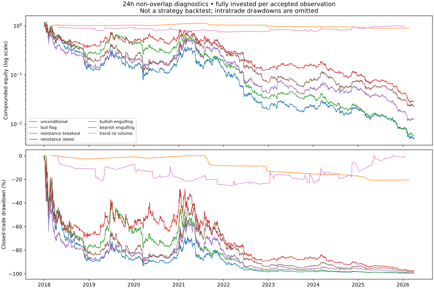
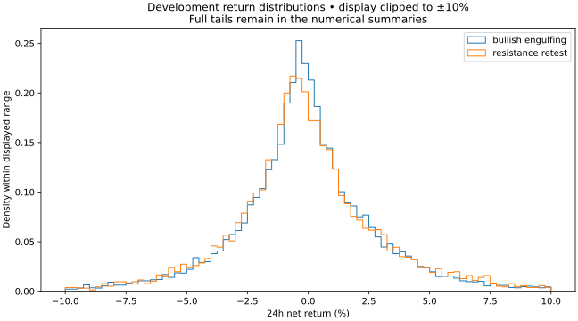

# Milestone 4 — Historical outcome and statistical research

Completed 2026-10-11. **No robust profitable edge has been established.** This is
exploratory development research, not out-of-sample evidence or a selected strategy.

## What was built

- Causal trend and volatility labels on 15m, with completed 1h/4h context.
- Separate 1/4/12/24-hour future paths on 5m data: returns, MFE/MAE, times to
  extrema, potential barrier hits and conservative first-exit labels.
- Standard, conditional BNB and stressed trading-cost assumptions.
- Seven frozen signal cohorts, unconditional long baseline, temporal/regime slices,
  calendar-block uncertainty, 28-test multiplicity correction and nonoverlap diagnostics.
- Protected readers, provenance/checksum catalogs, verified label reuse and plots.

Definitions and assumptions: [protocol](../../docs/STATISTICAL_RESEARCH.md).
No existing backtester or trading behavior was changed. No live orders were enabled.

## Primary 24-hour results

Five-minute entry delay; standard .10% fees plus .02% spread/slippage per side.
Returns below are per observation, with overlap. They are not daily portfolio returns.

| Cohort | Complete observations | Win rate | Mean net | Mean with conditional BNB | Mean stressed |
|---|---:|---:|---:|---:|---:|
| unconditional | 285,538 | 46.1% | -0.129% | -0.079% | -0.189% |
| bull_flag | 23 | 39.1% | -0.431% | -0.381% | -0.490% |
| resistance_breakout | 10,814 | 44.4% | -0.060% | -0.010% | -0.120% |
| resistance_retest | 6,426 | 44.9% | -0.063% | -0.013% | -0.123% |
| bullish_engulfing | 15,125 | 45.5% | -0.117% | -0.067% | -0.177% |
| bearish_engulfing | 14,907 | 46.5% | -0.121% | -0.071% | -0.181% |
| trend_rsi_volume | 548 | 42.2% | +0.017% | +0.067% | -0.043% |
| trend_rsi_volume_flag | 0 | — | — | — | — |

The indicator combination has 548 observations and average net return +0.017%,
but its 28-day-block 95% interval is **-0.460% to +0.441%**. It is negative in
2018–2023 (-0.115% mean) and positive in already-reused 2024–2026 Q1 (+0.207%).
This instability and uncertainty do not support selecting it for trading.
Adding the bull flag produces **zero** observations; the simpler flag cohort has
only 23. More conditions did not create usable evidence. No conditions were loosened
after inspecting these results.

## Statistical distinction: relative improvement can still lose money

Of the 28 primary signal/horizon tests, only long observations after bearish
engulfing at 1 hour pass the approximate BY correction (q≈0.022). Their excess
mean versus unconditional longs is +0.0209 percentage points, but their absolute
net mean is **-0.2142%** under standard fees and **-0.1643%** with conditional BNB.
That is relative improvement over a losing baseline, not a profitable edge.
Their 28-day-block net interval remains negative (-0.2256% to -0.2018%).
Bootstrap p-values are approximate and the reported minimum p=0.0002 is limited
by 4,999 resamples; q-values are not proof of out-of-sample reliability.

## Full horizon comparison

| Cohort | 1h mean net | 4h mean net | 12h mean net | 24h mean net |
|---|---:|---:|---:|---:|
| unconditional | -0.235% | -0.221% | -0.185% | -0.129% |
| bull_flag | -0.274% | -0.736% | -0.547% | -0.431% |
| resistance_breakout | -0.243% | -0.244% | -0.138% | -0.060% |
| resistance_retest | -0.252% | -0.259% | -0.154% | -0.063% |
| bullish_engulfing | -0.250% | -0.231% | -0.182% | -0.117% |
| bearish_engulfing | -0.214% | -0.190% | -0.157% | -0.121% |
| trend_rsi_volume | -0.224% | -0.243% | -0.078% | +0.017% |
| trend_rsi_volume_flag | — | — | — | — |

## Stability and regime reporting

`results.json` contains separate trend, volatility, joint trend/volatility, 1h/4h
context, data-pool and calendar-year slices, plus all cost and barrier summaries.
These slices are descriptive and were not scanned to declare new significant rules.
For illustration, the predeclared indicator combination at 24h varied as follows:

| Year | Observations | Mean net |
|---|---:|---:|
| 2018 | 12 | -1.532% |
| 2019 | 40 | +0.337% |
| 2020 | 98 | -0.332% |
| 2021 | 34 | -0.776% |
| 2022 | 33 | -0.931% |
| 2023 | 106 | +0.541% |
| 2024 | 151 | +0.160% |
| 2025 | 62 | +0.633% |
| 2026 | 12 | -1.400% |

2026 covers Q1 only. The worst year for this cohort is 2018 (-1.532%, only 12
observations), the best is 2025 (+0.633%, 62 observations). These are retrospective
descriptions, not evidence to select periods. The full file preserves other cohorts.

## Data quality and validation

| Horizon | Complete labels | Excluded labels |
|---|---:|---:|
| 1h | 288,380 | 145 |
| 4h | 288,008 | 517 |
| 12h | 287,016 | 1,509 |
| 24h | 285,538 | 2,987 |

288,525 feature observations produce 1,154,100 horizon-label records. Exclusions
are missing entries, path gaps or insufficient future data. Labels crossing 2024
are kept in a separate boundary bucket for pool-specific summaries. No valid label
extends into the reserved evaluation pool. Raw source gaps are never filled.

**74 tests pass**, including all 64 previous tests: hand-computed fees/returns,
delayed entry and exit boundaries, conservative dual-barrier ordering, stop gap
fills, incomplete paths, regime warm-up/prefix invariance, overlap filtering,
bootstrap reference cases, BY arithmetic, protected readers and split purging.
Full stored-file verification checks checksums, keys, feature/label separation,
cost monotonicity, excursion consistency and time boundaries. A second analysis
run reused identical verified label files and reproduced all primary summaries;
joint-regime slices were added without altering primary results.

## Figures

The equity/drawdown plot compounds full-capital returns for a deterministic
nonoverlapping subset, using closed-trade marks only. Many high-turnover cohorts
suffer extreme cumulative cost drag. This is a diagnostic, not a production
backtest: intratrade drawdowns, sizing and risk controls are not modeled.

## Provenance, limits and next step

Research snapshot: `b7858d6207a000be21d5d0939063dd98fb4f51887eb6bd68bbec909997fd3c94`.
All source IDs, code hashes, runtime versions, costs and seeds are in `results.json`.
Large data files remain excluded from Git. Reproduce with `python -m research.statistics`,
`python -m research.statistics.verify`, and `python -m research.statistics.render`.

Only 15m signal cohorts were evaluated; other pattern timeframes are not swept.
Fees/spreads/slippage are assumptions, not historical order-book measurements.
Fixed 2-ATR/3-ATR barriers are descriptive labels, not selected risk-management rules.
Unconditional long-return comparisons are included; buy-and-hold, portfolio-level
backtesting, walk-forward and sealed out-of-sample tests remain Milestone 6 work.

Stop for review before Milestone 5. There is no strategy ready to promote on this
evidence. Further discovery must register a limited new hypothesis family, account
for the experiments already performed, and preserve the reserved pool.
